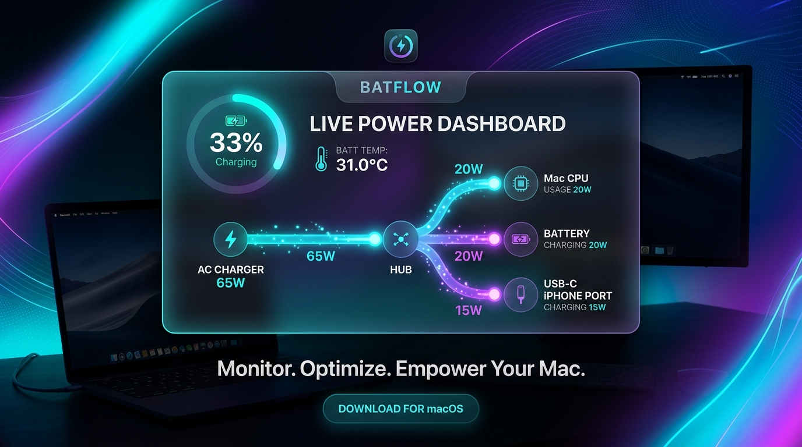

<div align="center">

# ⚡️ BatFlow

### Next-Generation Power Flow Telemetry & Battery Monitor for macOS

[](https://www.apple.com/macos)
[](https://swift.org)
[](LICENSE)
[](https://github.com/nelitow/BatFlow/releases/latest)

<br/>

## [⬇️ Download BatFlow for macOS](https://github.com/nelitow/BatFlow/releases/latest/download/BatFlow-macOS.zip)

> **Download · Unzip · Double-click to run.** No installer needed.
> Requires macOS 14 (Sonoma) or later.

<br/>



</div>

---

## 💡 Overview

**BatFlow** is an open-source, lightweight native macOS notch utility. Point at the notch (or press ⌃⌥N) and a panel drops down with live power telemetry, your Apple Reminders, your Linear issues and Slack unreads.

Built with Swift, SwiftUI, and low-level IOKit & Apple SMC interfaces, BatFlow provides a real-time power breakdown, Apple Silicon SMC battery temperature sensing and USB-C accessory wattage.

> [!NOTE]
> **Designed for macOS 15 & 27+**
> Recent macOS releases include native system battery charge management (such as the 80% charging limit). **BatFlow intentionally focuses on deep observability and rich visual telemetry** — real-time power breakdown, USB-C accessory wattage, SMC thermal monitoring and charge ETA — without interfering with macOS native power management routines.

---

## ✨ Features

- 🏝 **Notch Panel** — Point at the notch (or press ⌃⌥N) to drop down a panel with three cards: Power, Reminders and Linear. On Macs without a notch it opens from the top centre of the menu bar. Settings live behind the gear in the panel
- ⚡️ **Power** — Battery level, charge/drain ETA, and live watts for the adapter, system, battery and USB-C accessories, with a rolling power graph
- 🌡 **Precision SMC Battery Temperature** — Reads Apple Silicon SMC keys (`TB0T`, `TB1T`, `TB2T`) for exact temperature in °C or °F
- ✅ **Apple Reminders** — View, add and complete reminders in any of your lists. It edits your iCloud lists directly, so everything stays in sync with iPhone and Apple Watch
- 📋 **Linear** — Your assigned In Progress, In Review and Todo issues, read through the [Linear CLI](https://github.com/schpet/linear-cli) (`brew install schpet/tap/linear`, then `linear auth login`). Click an issue to open it
- 💬 **Slack Unreads** — Slack's Dock badge (mentions and DMs, or • for other unreads) in the notch header. Needs Accessibility access, no Slack token
- 🍃 **Zero Dependencies** — 100% native Swift & SwiftUI, ultra-low CPU and memory footprint. Nothing polls while the panel is closed

---

## 📦 Installation

### Option A — Direct Download (Recommended)

1. **[⬇️ Download BatFlow-macOS.zip](https://github.com/nelitow/BatFlow/releases/latest/download/BatFlow-macOS.zip)**
2. Unzip the file
3. Drag `BatFlow.app` to your **Applications** folder (optional but recommended)
4. Double-click to launch, then point at the notch or press ⌃⌥N. Open BatFlow again from Finder or Spotlight to show the panel

> If macOS shows a security warning, go to **System Settings → Privacy & Security** and click **Open Anyway**.

### Option B — Build from Source

Requirements: macOS 14.0+, Xcode 15+ / Command Line Tools.

```bash
git clone https://github.com/nelitow/BatFlow.git
cd BatFlow

mkdir -p build/cache BatFlow.app/Contents/MacOS BatFlow.app/Contents/Resources

swiftc -module-cache-path build/cache \
  -framework IOKit -framework AppKit -framework SwiftUI -framework Charts \
  -framework EventKit -framework Carbon \
  -parse-as-library -O \
  -o BatFlow.app/Contents/MacOS/BatFlow \
  Sources/BatFlow/*.swift

cp Info.plist BatFlow.app/Contents/Info.plist
codesign -s - --force --deep BatFlow.app
open BatFlow.app
```

---

## 🛠 Architecture

| Layer | Detail |
|---|---|
| **Battery State** | `AppleSmartBattery` IOKit — level %, voltage, amperage, charger wattage, port output, cycle count, health |
| **Temperature** | `AppleSMC` — float keys `TB0T` / `TB1T` / `TB2T` averaged for precision |
| **System Power** | SMC key `PSTR` for real-time CPU/board power draw |
| **UI** | Borderless notch panel (AppKit) hosting SwiftUI + Swift Charts, zero third-party dependencies |
| **Reminders** | EventKit, reading and writing your iCloud lists |
| **Linear** | `linear api` GraphQL query through the Linear CLI |
| **Slack** | Slack's Dock badge via the Dock's accessibility tree |
| **Release CI** | GitHub Actions — builds and publishes `BatFlow-macOS.zip` on every push to `main` |

---

## 🚀 CI/CD

Every push to `main` automatically:
1. Compiles `BatFlow.app` on `macos-latest`
2. Ad-hoc signs and packages `BatFlow-macOS.zip`
3. Auto-bumps the patch version and publishes a new numbered GitHub Release (e.g. `v1.0.1`) — always a fresh download at the link above

Push a specific tag (`git tag v1.x.x && git push origin v1.x.x`) to cut a manually chosen version instead.

---

## 📄 License

BatFlow is open-source under the [MIT License](LICENSE).

---

<div align="center">
Made with ❤️ for macOS · <a href="https://nelitow.github.io/BatFlow">Website</a> · <a href="https://github.com/nelitow/BatFlow/releases">Releases</a>
</div>
